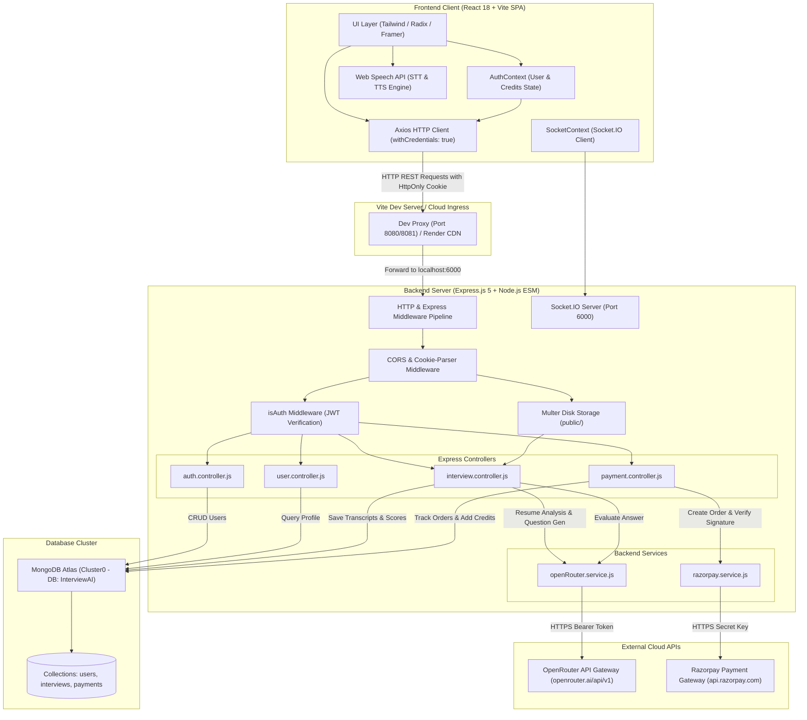
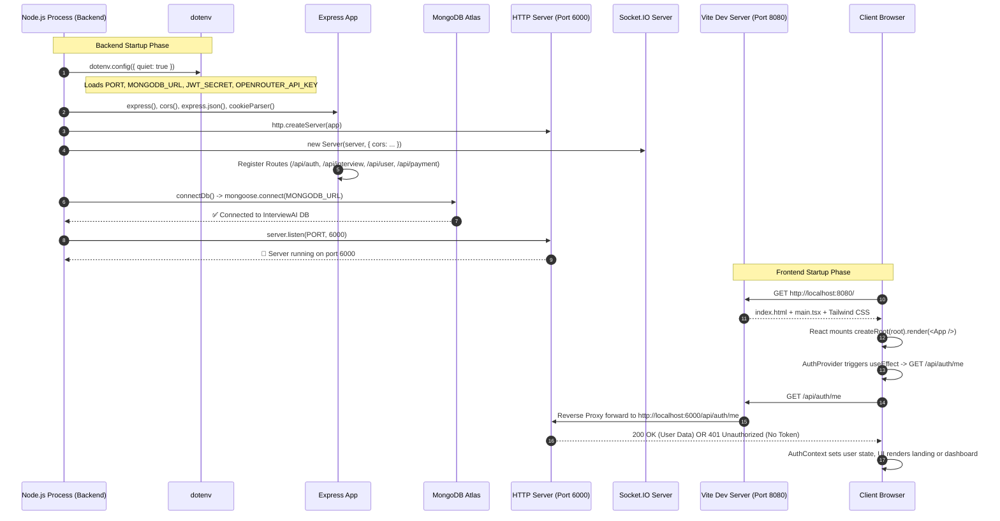
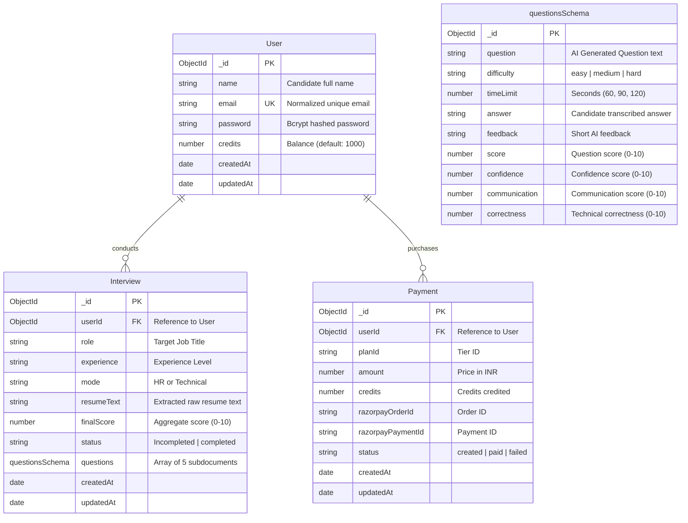
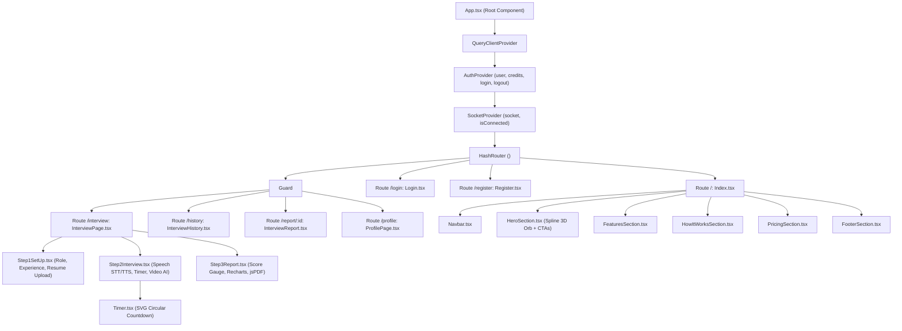

# InterviewAI — Complete Technical & Architectural Documentation

> **Document Type:** Production Architecture, Codebase Audit & MERN Technical Interview Guide  
> **Project Name:** InterviewAI (Full-Stack AI Mock Interview Platform)  
> **Repository Location:** `Interview AI Platform Project/` (`Frontend/` & `Backend/`)  
> **Author/Maintainer:** Vansh Garg  
> **Tech Stack:** MongoDB Atlas, Express.js (v5), React (v18) + TypeScript + Vite, Node.js (ESM), Socket.IO, OpenRouter AI, Razorpay

---

## Table of Contents
1. [Executive Summary](#1-executive-summary)
2. [High-Level Architecture & Communication Flow](#2-high-level-architecture--communication-flow)
3. [Complete Folder & File-by-File Blueprint](#3-complete-folder--file-by-file-blueprint)
4. [Startup & Execution Workflow](#4-startup--execution-workflow)
5. [Authentication & Session Lifecycle](#5-authentication--session-lifecycle)
6. [AI Interview Engine Workflow](#6-ai-interview-engine-workflow)
7. [Database Schemas & Mongoose Data Models](#7-database-schemas--mongoose-data-models)
8. [Comprehensive Backend API Reference](#8-comprehensive-backend-api-reference)
9. [Frontend Component Hierarchy & State Flow](#9-frontend-component-hierarchy--state-flow)
10. [Backend Layered Architecture & Request Pipeline](#10-backend-layered-architecture--request-pipeline)
11. [Environment Variables & Dependency Audit](#11-environment-variables--dependency-audit)
12. [In-Depth Security Audit & Vulnerability Assessment](#12-in-depth-security-audit--vulnerability-assessment)
13. [Testing, Diagnostics & Debugging Playbook](#13-testing-diagnostics--debugging-playbook)
14. [Placement Interview Preparation (MERN & System Design)](#14-placement-interview-preparation-mern--system-design)
15. [Implementation Status: Implemented vs. Incomplete Features](#15-implementation-status-implemented-vs-incomplete-features)
16. [Prioritized Learning Roadmap](#16-prioritized-learning-roadmap)

---

## 1. Executive Summary

### 1.1 Problem Statement & Solution
Technical and behavioral interview preparation is traditionally broken:
- Static coding platforms (e.g., LeetCode) test algorithmic knowledge in isolation without conversational articulation or verbal time pressure.
- Human peer mock interviews are expensive, non-scalable, inconsistent in grading standards, and difficult to schedule.
- Candidates often struggle with confidence, pacing, and clear verbal communication during high-stakes tech interviews.

**InterviewAI** solves this by providing an autonomous, full-stack, AI-powered mock interviewer. It parses a candidate's uploaded resume using PDF binary extraction, extracts their relevant skills and projects, customizes 5 progressive interview questions (Easy to Hard), and conducts a real-time conversational interview using web speech recognition (STT), speech synthesis (TTS), animated AI interviewer video avatars, question countdown timers, granular scoring (Confidence, Communication, Correctness), interactive Recharts visualizations, and downloadable PDF performance audits.

### 1.2 Technology Stack Overview

| Layer | Technology | Version | Purpose in Codebase |
| :--- | :--- | :--- | :--- |
| **Frontend Runtime & Bundler** | Vite + React (TypeScript) | React `18.3.1`, Vite `5.4.19` | High-speed ESM development server, SPA client, and production bundler. |
| **UI Design System** | Tailwind CSS + Radix UI Primitives | Tailwind `3.4.17` | Responsive dark-mode styling, glassmorphism, accessible dialogs, tooltips, and toasts. |
| **Animation & 3D** | Framer Motion + Spline | Framer `12.35.1`, Spline `4.1.0` | Motion graphics, staggered entrance transitions, and interactive 3D WebGL hero orb. |
| **Visual Analytics & PDF** | Recharts + jsPDF / autoTable | Recharts `2.15.4`, jsPDF `4.2.1` | SVG performance charts and client-side vector PDF report generation. |
| **Client Speech Interfaces** | Web Speech API | Native Browser Web API | `webkitSpeechRecognition` (speech-to-text) & `SpeechSynthesis` (text-to-speech). |
| **Backend Framework** | Node.js (ESM) + Express.js | Express `5.2.1` | Asynchronous RESTful API server, routing, and controller execution. |
| **Real-Time Layer** | Socket.IO | Server `4.8.3`, Client `4.8.3` | Bi-directional WebSocket communication and personal room management (`join_room`). |
| **Database & ODM** | MongoDB Atlas + Mongoose | Mongoose `9.2.1` | NoSQL document storage for users, interview transcripts, scores, and payments. |
| **Authentication** | JWT (`jsonwebtoken`) + `bcryptjs` | JWT `9.0.3`, bcrypt `3.0.3` | Salted password hashing and stateless token issuance via `HttpOnly` cookies. |
| **AI LLM Gateway** | OpenRouter API (`axios`) | Custom Service | Orchestrates LLM requests to models like `openai/gpt-4o-mini` with custom prompt engineering. |
| **File Ingestion** | Multer + `pdfjs-dist` | Multer `2.0.2`, PDF.js `5.4.624` | Disk buffering of candidate resumes and binary text stream extraction. |
| **Payment Gateway** | Razorpay Node SDK | Razorpay `2.9.6` | Order initialization and HMAC SHA256 cryptographic webhook/signature verification. |

---

## 2. High-Level Architecture & Communication Flow

### 2.1 Component Interaction Architecture



---

## 3. Complete Folder & File-by-File Blueprint

### 3.1 Project Tree Structure (Production Clean)

```text
Interview AI Platform Project/
├── DEPLOYMENT.md
├── README.md
├── scripts/
│   └── check_deploy.js
├── Backend/
│   ├── .env
│   ├── .env.example
│   ├── .gitignore
│   ├── index.js
│   ├── package.json
│   ├── package-lock.json
│   ├── config/
│   │   ├── connectDb.js
│   │   ├── db.js                [Unused Legacy Postgres Config]
│   │   └── token.js
│   ├── controllers/
│   │   ├── auth.controller.js
│   │   ├── interview.controller.js
│   │   ├── payment.controller.js
│   │   └── user.controller.js
│   ├── middlewares/
│   │   ├── error.js
│   │   ├── isAuth.js
│   │   └── multer.js
│   ├── models/
│   │   ├── interview.model.js
│   │   ├── payment.model.js
│   │   └── user.model.js
│   ├── public/                  [Multer Temp Storage Directory]
│   ├── routes/
│   │   ├── auth.route.js
│   │   ├── interview.route.js
│   │   ├── payment.route.js
│   │   └── user.route.js
│   └── services/
│       ├── openRouter.service.js
│       └── razorpay.service.js
└── Frontend/
    ├── package.json
    ├── package-lock.json
    ├── postcss.config.js
    ├── tailwind.config.ts
    ├── tsconfig.json
    ├── tsconfig.app.json
    ├── tsconfig.node.json
    ├── vite.config.ts
    ├── index.html
    └── src/
        ├── main.tsx
        ├── App.tsx
        ├── App.css
        ├── index.css
        ├── vite-env.d.ts
        ├── assets/
        │   ├── videos/
        │   │   ├── male-ai.mp4
        │   │   └── female-ai.mp4
        │   └── *.png (HR, MM, confi, ai-ans, credit, history, etc.)
        ├── components/
        │   ├── NavLink.tsx
        │   ├── interview/
        │   │   ├── Step1SetUp.tsx
        │   │   ├── Step2Interview.tsx
        │   │   ├── Step3Report.tsx
        │   │   └── Timer.tsx
        │   ├── landing/
        │   │   ├── FeaturesSection.tsx
        │   │   ├── FooterSection.tsx
        │   │   ├── ForWhomSection.tsx
        │   │   ├── HeroSection.tsx
        │   │   ├── HowItWorksSection.tsx
        │   │   ├── Navbar.tsx
        │   │   ├── PricingSection.tsx
        │   │   └── TechStackSection.tsx
        │   └── ui/ (49 Radix/Shadcn UI component primitives)
        ├── context/
        │   ├── AuthContext.tsx
        │   └── SocketContext.tsx
        ├── hooks/
        │   ├── use-mobile.tsx
        │   └── use-toast.ts
        ├── lib/
        │   └── utils.ts
        ├── pages/
        │   ├── Index.tsx
        │   ├── InterviewHistory.tsx
        │   ├── InterviewPage.tsx
        │   ├── InterviewReport.tsx
        │   ├── Login.tsx
        │   ├── NotFound.tsx
        │   ├── ProfilePage.tsx
        │   └── Register.tsx
        ├── services/
        │   └── api.ts
        └── test/
            ├── example.test.ts
            └── setup.ts
```

---

### 3.2 Backend File Audit

#### 1. `Backend/index.js`
- **Purpose:** Server bootstrap entry point. Initializes Express, creates an HTTP server, binds Socket.IO, registers CORS, parses JSON/cookies, registers routers, sets up global error handling, and orchestrates the database connection prior to listening on `process.env.PORT`.
- **Dependencies:** `express`, `dotenv`, `mongoose`, `./config/connectDb.js`, `cookie-parser`, `http`, `socket.io`, `cors`, route handlers, `./middlewares/error.js`.
- **Impact of Removal:** Complete application failure; backend will not boot.
- **Classification:** **Essential (Core Entry Point)**.

#### 2. `Backend/config/connectDb.js`
- **Purpose:** Manages the Mongoose connection lifecycle to MongoDB Atlas. Includes a Windows-specific DNS resolver workaround (`dns.setServers(["8.8.8.8", "1.1.1.1"])`) to reliably resolve MongoDB SRV records (`_mongodb._tcp`), logs connection states, masks credentials in logs, and sets socket timeouts (`15000ms`).
- **Dependencies:** `node:dns`, `mongoose`.
- **Impact of Removal:** Database operations fail; server cannot persist or query users and interviews.
- **Classification:** **Essential (Database Infrastructure)**.

#### 3. `Backend/config/db.js`
- **Purpose:** Contains a PostgreSQL connection pool (`new Pool({...})`) reading `process.env.DATABASE_URL`.
- **Dependencies:** `pg` (CommonJS `require`).
- **Audit Finding:** **Unused / Dead Code.** `package.json` specifies `"type": "module"`, and no other file imports `db.js`. MongoDB is the actual database used.
- **Classification:** **Optional / Deprecated Legacy File**.

#### 4. `Backend/config/token.js`
- **Purpose:** Signs JSON Web Tokens (`jwt.sign`) using `{ userId }`, `process.env.JWT_SECRET`, and a 7-day expiration (`expiresIn: "7d"`).
- **Dependencies:** `jsonwebtoken`.
- **Impact of Removal:** Authentication breaks; users cannot receive login/registration session cookies.
- **Classification:** **Essential (Security & Auth)**.

#### 5. `Backend/middlewares/isAuth.js`
- **Purpose:** Route gatekeeper. Intercepts incoming requests, reads `req.cookies.token`, decodes and verifies the JWT via `process.env.JWT_SECRET`, extracts `userId`, and assigns it to `req.userId`.
- **Dependencies:** `jsonwebtoken`.
- **Impact of Removal:** Route protection fails; unauthorized users could access private interview sessions and profile data.
- **Classification:** **Essential (Authorization Middleware)**.

#### 6. `Backend/middlewares/multer.js`
- **Purpose:** Configures multipart file uploads for resume processing. Uses `diskStorage` writing to `public/` with timestamps prefixing the original filename and enforces a 5MB size limit.
- **Dependencies:** `multer`.
- **Impact of Removal:** Resume uploads fail on `/api/interview/resume`.
- **Classification:** **Essential (File Upload Infrastructure)**.

#### 7. `Backend/middlewares/error.js`
- **Purpose:** Centralized Express error handler (`err, req, res, next`). Writes structured error messages and stack traces to `Backend/logs/error.log` and returns JSON responses to clients, hiding stack traces in production.
- **Dependencies:** `fs`, `path`, `url`.
- **Impact of Removal:** Unhandled errors crash the process or return default Express HTML 500 error pages.
- **Classification:** **Essential (Reliability & Logging)**.

#### 8. `Backend/models/user.model.js`
- **Purpose:** Mongoose schema defining the `User` document: `name` (String, required), `email` (String, unique, required), `password` (String, required), and `credits` (Number, default 1000).
- **Dependencies:** `mongoose`.
- **Impact of Removal:** User registration, authentication, credit checks, and profile lookups fail.
- **Classification:** **Essential (Data Model)**.

#### 9. `Backend/models/interview.model.js`
- **Purpose:** Mongoose schema defining the `Interview` document and its embedded `questionsSchema` subdocuments (`question`, `difficulty`, `timeLimit`, `answer`, `feedback`, `score`, `confidence`, `communication`, `correctness`). Contains references to `User` (`userId`), interview `role`, `experience`, `mode` (`HR` or `Technical`), `resumeText`, `finalScore`, and `status` (`Incompleted` or `completed`).
- **Dependencies:** `mongoose`.
- **Impact of Removal:** The core AI interview flow cannot save generated questions, answers, scores, or history.
- **Classification:** **Essential (Data Model)**.

#### 10. `Backend/models/payment.model.js`
- **Purpose:** Mongoose schema defining payment transaction logs: `userId`, `planId`, `amount`, `credits`, `razorpayOrderId`, `razorpayPaymentId`, and `status` (`created`, `paid`, `failed`).
- **Dependencies:** `mongoose`.
- **Impact of Removal:** Payment tracking and audit trails fail.
- **Classification:** **Essential (Financial Data Model)**.

#### 11. `Backend/routes/auth.route.js`
- **Purpose:** Defines auth endpoints: `POST /register`, `POST /login`, `POST /logout`, and `GET /me` (protected with `isAuth`).
- **Dependencies:** `express`, `../controllers/auth.controller.js`, `../middlewares/isAuth.js`.
- **Classification:** **Essential (Routing)**.

#### 12. `Backend/routes/interview.route.js`
- **Purpose:** Defines interview endpoints: `POST /resume` (with `upload.single("resume")`), `POST /generate-questions`, `POST /submit-answer`, `POST /finish`, `GET /get-interview`, and `GET /report/:id`. All protected with `isAuth`.
- **Dependencies:** `express`, `../controllers/interview.controller.js`, `../middlewares/isAuth.js`, `../middlewares/multer.js`.
- **Classification:** **Essential (Core Domain Routing)**.

#### 13. `Backend/routes/payment.route.js` & `Backend/routes/user.route.js`
- **Purpose:** Routes for Razorpay order generation (`POST /api/payment/order`), payment verification (`POST /api/payment/verify`), and retrieving user details (`GET /api/user/current-user`).
- **Dependencies:** `express`, respective controllers, `isAuth`.
- **Classification:** **Essential (Domain Routing)**.

#### 14. `Backend/controllers/auth.controller.js`
- **Purpose:** Implements business logic for user registration (validating fields, hashing passwords with bcrypt 10 salt rounds, generating JWT, setting 7-day cookie), login (credential comparison), logout (`clearCookie`), and `getMe` (fetching user without password).
- **Dependencies:** `bcryptjs`, `mongoose`, `../config/token.js`, `../models/user.model.js`.
- **Classification:** **Essential (Controller)**.

#### 15. `Backend/controllers/interview.controller.js`
- **Purpose:** The core intelligence hub:
  - `analyzeResume`: Reads uploaded PDF using `pdfjs-dist`, extracts raw text, calls OpenRouter to parse role/skills/projects into JSON, and deletes the uploaded file.
  - `generateQuestion`: Validates minimum 50 credits, deducts 50 credits from the user, queries OpenRouter to generate 5 progressive questions, and stores a new `Interview` document.
  - `submitAnswer`: Validates answer length and time limits; prompts OpenRouter to grade the answer on Confidence, Communication, and Correctness (0-10) with human-like feedback, updating question subdocuments in MongoDB.
  - `finishInterview`: Computes arithmetic averages for overall scores and marks the session `"completed"`.
  - `getMyInterviews`: Queries user interview history sorted descending by `createdAt`.
  - `getInterviewReport`: Fetches full interview breakdown and calculates averages for reporting.
- **Dependencies:** `fs`, `pdfjs-dist/legacy/build/pdf.mjs`, `../services/openRouter.service.js`, `../models/user.model.js`, `../models/interview.model.js`.
- **Classification:** **Essential (Core Controller)**.

#### 16. `Backend/controllers/payment.controller.js`
- **Purpose:** Creates Razorpay orders in paise via `razorpay.orders.create` and verifies payment authenticity using `crypto.createHmac("sha256", process.env.RAZORPAY_KEY_SECRET)`. On signature match, sets payment status to `paid` and increments user credits (`$inc`).
- **Dependencies:** `crypto`, `../models/payment.model.js`, `../models/user.model.js`, `../services/razorpay.service.js`.
- **Classification:** **Essential (Payment Processing)**.

#### 17. `Backend/controllers/user.controller.js`
- **Purpose:** Implements `getCurrentUser` to return the logged-in user document.
- **Dependencies:** `../models/user.model.js`.
- **Classification:** **Essential (Controller)**.

#### 18. `Backend/services/openRouter.service.js`
- **Purpose:** Robust HTTP interface for OpenRouter AI completions (`https://openrouter.ai/api/v1/chat/completions`). Features API key validation, 35-second timeout handling, custom diagnostic logging without credential leakage, and explicit handling of HTTP 401, 402, 403, 404, 429, and 5xx errors.
- **Dependencies:** `axios`.
- **Classification:** **Essential (AI Infrastructure Service)**.

#### 19. `Backend/services/razorpay.service.js`
- **Purpose:** Instantiates the Razorpay SDK client with `process.env.RAZORPAY_KEY_ID` and `process.env.RAZORPAY_KEY_SECRET`.
- **Dependencies:** `razorpay`, `dotenv`.
- **Classification:** **Essential (Payment Infrastructure Service)**.

---

### 3.3 Frontend File Audit

#### 1. `Frontend/src/main.tsx` & `Frontend/src/App.tsx`
- **Purpose:** `main.tsx` is the React root entry point using `createRoot`. `App.tsx` sets up top-level providers (`QueryClientProvider`, `AuthProvider`, `SocketProvider`, `TooltipProvider`, `Toaster`, `Sonner`) and configures `HashRouter` with a `ProtectedRoute` wrapper guarding `/interview`, `/history`, `/report/:id`, and `/profile`.
- **Dependencies:** `react-dom/client`, `react-router-dom`, `@tanstack/react-query`, context providers.
- **Classification:** **Essential (Application Entry & Routing)**.

#### 2. `Frontend/src/services/api.ts`
- **Purpose:** Centralized Axios instance. Dynamically configures `baseURL` from `import.meta.env.VITE_API_URL` or defaults to `/api`. Enforces `withCredentials: true` so HttpOnly cookies are automatically attached to cross-origin or proxied requests. Contains a response interceptor that catches 401 Unauthorized errors and redirects unauthenticated users to `/login`.
- **Dependencies:** `axios`.
- **Classification:** **Essential (Networking Layer)**.

#### 3. `Frontend/src/context/AuthContext.tsx`
- **Purpose:** React Context providing global user state (`user`, `setUser`, `logout`). On application mount, executes `GET /api/auth/me` to automatically restore active sessions from HttpOnly cookies.
- **Dependencies:** `react`, `../services/api`.
- **Classification:** **Essential (Global State)**.

#### 4. `Frontend/src/context/SocketContext.tsx`
- **Purpose:** Manages WebSocket connections via `socket.io-client`. Automatically connects to the backend when `user` is authenticated and emits `join_room` with `user._id` to establish a private user channel.
- **Dependencies:** `socket.io-client`, `./AuthContext`.
- **Classification:** **Essential (Real-Time State)**.

#### 5. `Frontend/src/pages/InterviewPage.tsx`
- **Purpose:** Orchestrator page for mock interviews. Manages step state (`1`, `2`, `3`):
  - Step 1: `<Step1SetUp onStart={...} />`
  - Step 2: `<Step2Interview interviewData={...} onFinish={...} />`
  - Step 3: `<Step3Report report={...} />`
- **Classification:** **Essential (Feature Page)**.

#### 6. `Frontend/src/components/interview/Step1SetUp.tsx`
- **Purpose:** Form for configuring role, experience, mode (Technical/HR), and uploading a resume. Handles multipart PDF upload to `/api/interview/resume`, populates extracted skills, checks user credit balance, and calls `/api/interview/generate-questions`.
- **Dependencies:** `framer-motion`, `lucide-react`, `sonner`, `../../services/api`, `../../context/AuthContext`.
- **Classification:** **Essential (Interview Setup)**.

#### 7. `Frontend/src/components/interview/Step2Interview.tsx`
- **Purpose:** The active interview room. Features:
  - Video avatar synchronization: Plays `male-ai.mp4` or `female-ai.mp4` when AI speaks.
  - Browser Speech Synthesis: Pronounces AI questions with voice gender selection.
  - Web Speech API: Listens to candidate responses and transcribes them in real time.
  - Timers: Countdown timer per question via `<Timer />`.
  - Automatic submission on timer expiration.
  - Submits answers to `/api/interview/submit-answer` and ends with `/api/interview/finish`.
- **Dependencies:** Web Speech API, `../../services/api`, HTML5 Video, Framer Motion.
- **Classification:** **Essential (Core Interview Engine)**.

#### 8. `Frontend/src/components/interview/Step3Report.tsx`
- **Purpose:** Performance analytics screen. Renders:
  - Circular SVG score gauge (`finalScore / 10`).
  - Skill breakdown progress bars (Confidence, Communication, Correctness).
  - Recharts Area Chart displaying score trends across questions.
  - Question-by-question accordion with AI feedback.
  - Client-side PDF export button using `jspdf` and `jspdf-autotable`.
- **Dependencies:** `recharts`, `jspdf`, `jspdf-autotable`, `framer-motion`.
- **Classification:** **Essential (Reporting & Analytics)**.

#### 9. `Frontend/src/components/interview/Timer.tsx`
- **Purpose:** Reusable SVG circular timer component. Calculates circumference offset dynamically based on elapsed time and transitions color from emerald to yellow to red.
- **Classification:** **Essential (UI Component)**.

#### 10. `Frontend/src/pages/InterviewHistory.tsx` & `InterviewReport.tsx`
- **Purpose:** `InterviewHistory.tsx` queries `/api/interview/get-interview` to display a grid of past interview cards with scores, dates, and completion tags. Clicking a card navigates to `/report/:id`, where `InterviewReport.tsx` fetches the historical report and re-renders `<Step3Report />`.
- **Classification:** **Essential (Archive & History)**.

#### 11. `Frontend/src/pages/Login.tsx` & `Register.tsx`
- **Purpose:** Authentication pages. Validates user input, sends credentials to `/api/auth/login` and `/api/auth/register`, updates `AuthContext`, shows feedback toasts, and navigates to the homepage.
- **Classification:** **Essential (Authentication UI)**.

#### 12. `Frontend/src/pages/ProfilePage.tsx`
- **Purpose:** Displays user profile details (Name, Email, User ID, Available Credits) and provides logout and quick navigation buttons.
- **Classification:** **Essential (User Profile)**.

#### 13. `Frontend/src/components/landing/*`
- **Purpose:** Modular landing page sections:
  - `Navbar.tsx`: Sticky glassmorphic navbar with dynamic credit pill and profile links.
  - `HeroSection.tsx`: Headline, CTA buttons, interactive demo modal, and 3D Spline avatar orb.
  - `FeaturesSection.tsx`: 6 grid cards outlining platform capabilities.
  - `HowItWorksSection.tsx`: 3-step setup walkthrough.
  - `ForWhomSection.tsx`: Target audience cards.
  - `TechStackSection.tsx`: Technology badge display.
  - `PricingSection.tsx`: 3-tier pricing card display.
  - `FooterSection.tsx`: Footer links and branding.
- **Classification:** **Essential (Public Presentation)**.

---

## 4. Startup & Execution Workflow

### 4.1 Step-by-Step Initialization Sequence



---

## 5. Authentication & Session Lifecycle

### 5.1 Registration & Login Sequence Diagram

```mermaid
sequenceDiagram
    autonumber
    participant User as Candidate Browser
    participant API as Axios (/services/api.ts)
    participant Route as Express (/api/auth)
    participant AuthCtrl as auth.controller.js
    participant Bcrypt as bcryptjs
    participant Token as token.js (JWT)
    participant DB as MongoDB Atlas (users)

    %% Registration Flow
    Note over User,DB: Registration Flow
    User->>API: POST /api/auth/register { name, email, password }
    API->>Route: HTTP POST (JSON Payload)
    Route->>AuthCtrl: register(req, res)
    AuthCtrl->>DB: User.findOne({ email: normalizedEmail })
    DB-->>AuthCtrl: null (User does not exist)
    AuthCtrl->>Bcrypt: genSalt(10) -> hash(password, salt)
    Bcrypt-->>AuthCtrl: hashedPassword
    AuthCtrl->>DB: User.create({ name, email, password: hashedPassword, credits: 1000 })
    DB-->>AuthCtrl: Created User Document (_id)
    AuthCtrl->>Token: genToken(user._id)
    Token-->>AuthCtrl: Signed JWT (expiresIn: 7d)
    AuthCtrl-->>User: Set-Cookie: token=<JWT>; HttpOnly; SameSite=Lax; Max-Age=7d<br/>Status: 201 Created { _id, name, email, credits }

    %% Subsequent Authenticated Request
    Note over User,DB: Session Verification Flow (Mounting App)
    User->>API: GET /api/auth/me (Cookie automatically attached)
    API->>Route: HTTP GET /api/auth/me
    Route->>AuthCtrl: isAuth Middleware
    AuthCtrl->>AuthCtrl: jwt.verify(req.cookies.token, JWT_SECRET)
    AuthCtrl->>DB: User.findById(req.userId).select("-password")
    DB-->>AuthCtrl: User Document (Sanitized)
    AuthCtrl-->>User: Status: 200 OK { _id, name, email, credits }
```

### 5.2 Key Security Implementation Details
- **Password Protection:** Uses `bcryptjs` with salt round `10`. Passwords are never stored or transmitted in plain text.
- **JWT Storage:** Tokens are issued inside an `HttpOnly` cookie. This makes them inaccessible to client-side JavaScript, preventing Cross-Site Scripting (XSS) token theft.
- **SameSite Policy:** Configured dynamically:
  ```js
  sameSite: process.env.NODE_ENV === "production" ? "none" : "lax",
  secure: process.env.NODE_ENV === "production"
  ```
  In production across cross-origin deployments (e.g., Render frontend to Render backend), `sameSite: "none"` and `secure: true` allow cross-site cookie transmission over HTTPS.

---

## 6. AI Interview Engine Workflow

### 6.1 End-to-End Execution Sequence

```mermaid
sequenceDiagram
    autonumber
    participant UI as Step1SetUp / Step2Interview
    participant Back as interview.controller.js
    participant OpenRouter as openRouter.service.js
    participant LLM as OpenRouter Gateway (openai/gpt-4o-mini)
    participant DB as MongoDB Atlas (interviews)

    %% Step 1: Generation
    Note over UI,LLM: Phase 1: Setup & Question Generation
    UI->>Back: POST /api/interview/generate-questions { role, experience, mode, resumeText }
    Back->>Back: Verify user.credits >= 50
    Back->>OpenRouter: askAi(messagesWithRoleAndExperience)
    OpenRouter->>LLM: HTTPS POST /chat/completions (Bearer OPENROUTER_API_KEY)
    LLM-->>OpenRouter: 5 Structured Questions (Easy to Hard)
    OpenRouter-->>Back: Formatted Text Output
    Back->>DB: Interview.create({ userId, role, experience, questions: [...] })
    Back->>Back: user.credits -= 50; await user.save()
    Back-->>UI: 200 OK { interviewId, questions, creditsLeft }

    %% Step 2: Evaluation
    Note over UI,LLM: Phase 2: Live Question Evaluation
    UI->>Back: POST /api/interview/submit-answer { interviewId, questionIndex, answer, timeTaken }
    Back->>OpenRouter: askAi(scoringPromptWithRubric)
    OpenRouter->>LLM: Evaluate Confidence, Communication, Correctness
    LLM-->>OpenRouter: JSON: { confidence: 8, communication: 7, correctness: 9, finalScore: 8, feedback: "..." }
    OpenRouter-->>Back: Parsed JSON
    Back->>DB: Update question subdocument in MongoDB
    Back-->>UI: 200 OK { feedback }
    UI->>UI: SpeechSynthesis speaks AI feedback

    %% Step 3: Finish
    Note over UI,DB: Phase 3: Session Completion
    UI->>Back: POST /api/interview/finish { interviewId }
    Back->>DB: Calculate overall averages & mark status: "completed"
    Back-->>UI: 200 OK { finalScore, confidence, communication, correctness, questionWiseScore }
    UI->>UI: Navigate to Step3Report Analytics Dashboard
```

---

## 7. Database Schemas & Mongoose Data Models

### 7.1 Entity-Relationship (ER) Diagram



---

## 8. Comprehensive Backend API Reference

| Method | Endpoint Path | Auth Req. | Payload / Params | Controller & Service | Expected Success Response | Possible Error Codes |
| :--- | :--- | :--- | :--- | :--- | :--- | :--- |
| `POST` | `/api/auth/register` | No | `{ name, email, password }` | `register` in `auth.controller.js` | `201 Created` with User object & Set-Cookie | `400` (Missing fields/Exists), `503` (DB offline) |
| `POST` | `/api/auth/login` | No | `{ email, password }` | `login` in `auth.controller.js` | `200 OK` with User object & Set-Cookie | `400` (Missing fields), `401` (Invalid credentials) |
| `POST` | `/api/auth/logout` | No | None | `logOut` in `auth.controller.js` | `200 OK` `{ message: "LogOut Successfully" }` | `500` (Server error) |
| `GET` | `/api/auth/me` | **Yes** (`isAuth`) | None | `getMe` in `auth.controller.js` | `200 OK` with User (excluding password) | `401` (Missing/Invalid JWT), `404` (Not found) |
| `GET` | `/api/user/current-user` | **Yes** (`isAuth`) | None | `getCurrentUser` in `user.controller.js` | `200 OK` with User document | `401` (Unauthorized), `404` (Not found) |
| `POST` | `/api/interview/resume` | **Yes** (`isAuth`) | `multipart/form-data` with `resume` (PDF) | `analyzeResume` + `pdfjs-dist` + OpenRouter | `200 OK` `{ role, experience, projects, skills, resumeText }` | `400` (No file), `500` (PDF parse / AI error) |
| `POST` | `/api/interview/generate-questions` | **Yes** (`isAuth`) | `{ role, experience, mode, resumeText, projects, skills }` | `generateQuestion` + OpenRouter | `200 OK` `{ interviewId, creditsLeft, userName, questions }` | `400` (Bad prompt / < 50 credits), `500` (AI fail) |
| `POST` | `/api/interview/submit-answer` | **Yes** (`isAuth`) | `{ interviewId, questionIndex, answer, timeTaken }` | `submitAnswer` + OpenRouter | `200 OK` `{ feedback }` | `400` (Invalid payload), `500` (Evaluation fail) |
| `POST` | `/api/interview/finish` | **Yes** (`isAuth`) | `{ interviewId }` | `finishInterview` in `interview.controller.js` | `200 OK` `{ finalScore, confidence, communication, correctness, questionWiseScore }` | `400` (Interview not found), `500` (DB fail) |
| `GET` | `/api/interview/get-interview` | **Yes** (`isAuth`) | None | `getMyInterviews` in `interview.controller.js` | `200 OK` `[{ _id, role, experience, mode, finalScore, status, createdAt }]` | `401` (Unauthorized), `500` (DB fail) |
| `GET` | `/api/interview/report/:id` | **Yes** (`isAuth`) | `req.params.id` (Interview ID) | `getInterviewReport` in `interview.controller.js` | `200 OK` `{ finalScore, confidence, communication, correctness, questionWiseScore }` | `404` (Interview not found), `500` (DB fail) |
| `POST` | `/api/payment/order` | **Yes** (`isAuth`) | `{ planId, amount, credits }` | `createOrder` + `razorpay.service.js` | `200 OK` with Razorpay Order object | `400` (Invalid plan data), `500` (Razorpay fail) |
| `POST` | `/api/payment/verify` | **Yes** (`isAuth`) | `{ razorpay_order_id, razorpay_payment_id, razorpay_signature }` | `verifyPayment` (HMAC SHA256 check) | `200 OK` `{ success: true, user: updatedUser }` | `400` (Invalid signature), `404` (Order not found) |
| `GET` | `/api/health` | No | None | Anonymous handler in `index.js` | `200 OK` `{ status: "ok", db: "connected", dbReadyState: 1 }` | None |

---

## 9. Frontend Component Hierarchy & State Flow

### 9.1 Component Tree Diagram



---

## 10. Backend Layered Architecture & Request Pipeline

### 10.1 Layer Responsibilities & Separation of Concerns

1. **Server Layer (`index.js`):** Instantiates the server, configures CORS and protocol parsing, binds WebSockets, and mounts URL prefix routers (`/api/auth`, `/api/interview`, etc.).
2. **Middleware Layer (`middlewares/`):** Pre-processes requests before controller execution.
   - `isAuth.js`: Validates the JWT cookie and attaches `req.userId`.
   - `multer.js`: Streams binary multipart file buffers to disk.
   - `error.js`: Intercepts unhandled errors, logs them to `logs/error.log`, and formats error responses.
3. **Routing Layer (`routes/`):** Declarative endpoint definitions mapping HTTP verbs and pathnames to middleware chains and controller methods.
4. **Controller Layer (`controllers/`):** Orchestrates business workflows, validates request parameters, calls external services, handles errors, and returns JSON responses.
5. **Service Layer (`services/`):** Encapsulates third-party integrations (OpenRouter LLM calls and Razorpay SDK commands).
6. **Model Layer (`models/`):** Enforces data consistency, field validation, default values, and schema definitions in MongoDB Atlas.

---

## 11. Environment Variables & Dependency Audit

### 11.1 Backend Environment Variables Reference

| Variable Name | Required | Default / Fallback | Purpose & Behavior if Missing |
| :--- | :--- | :--- | :--- |
| `PORT` | Optional | `6000` | Port for Express and Socket.IO. |
| `NODE_ENV` | Optional | `development` | Dictates cookie security flags and error stack trace visibility. |
| `MONGODB_URL` | **Required** | None | MongoDB Atlas connection string. If missing, database connection fails. |
| `JWT_SECRET` | **Required** | None | Secret key for signing and verifying authentication tokens. |
| `OPENROUTER_API_KEY`| **Required** | None | API key for OpenRouter AI. If missing, AI generation fails. |
| `OPENROUTER_MODEL` | Optional | `openai/gpt-4o-mini` | LLM model identifier on OpenRouter. |
| `RAZORPAY_KEY_ID` | Optional | None | Razorpay Key ID for payments. |
| `RAZORPAY_KEY_SECRET`| Optional | None | Razorpay Key Secret for webhook/signature verification. |
| `FRONTEND_URL` | Optional | `http://localhost:5173` | Allowed origin for CORS headers. |

### 11.2 Frontend Environment Variables Reference

| Variable Name | Required | Default / Fallback | Purpose & Behavior if Missing |
| :--- | :--- | :--- | :--- |
| `VITE_API_URL` | Optional | `""` (Empty string) | Backend API base URL. In development, defaults to empty and Vite proxies `/api` and `/socket.io` to `http://localhost:6000`. |

---

## 12. In-Depth Security Audit & Vulnerability Assessment

### Findings Summary Table

| ID | Vulnerability / Concern | Severity | Location in Codebase | Recommended Remediation |
| :--- | :--- | :--- | :--- | :--- |
| **SEC-01** | `password` returned by `getCurrentUser` | **High** | `Backend/controllers/user.controller.js:7-11` | Add `.select("-password")` so the bcrypt hash is never transmitted over the wire. |
| **SEC-02** | Wildcard / permissive CORS in non-prod | **Medium** | `Backend/index.js:58-67` | When testing locally, ensure credentials are explicitly scoped rather than using broad origin reflections. |
| **SEC-03** | Lack of rate limiting on Auth & AI routes | **Medium** | `Backend/routes/auth.route.js` & `interview.route.js` | Implement `express-rate-limit` to prevent brute-force attacks and credit depletion. |
| **SEC-04** | Multer unvalidated file extensions | **Medium** | `Backend/middlewares/multer.js:14-17` | Add a `fileFilter` verifying MIME type `application/pdf` before saving files to disk. |
| **SEC-05** | Unused PostgreSQL configuration | **Low** | `Backend/config/db.js` & `Backend/package.json` | Remove `pg` dependency and `db.js` to eliminate dead code and reduce attack surface. |

---

## 13. Testing, Diagnostics & Debugging Playbook

### 13.1 Running the Project Locally
1. **Start Backend Server:**
   ```powershell
   cd "Backend"
   npm install
   npm run dev
   ```
   *Expected output:*
   ```text
   🚀 Server running on port 6000
      MongoDB: ✅ Connected
      Health:  http://localhost:6000/api/health
   ```
2. **Start Frontend Server:**
   ```powershell
   cd "Frontend"
   npm install
   npm run dev
   ```
   *Expected output:*
   ```text
   VITE v5.4.19  ready in 840 ms
   ➜  Local:   http://localhost:8080/ (or 8081 if 8080 is occupied)
   ```

### 13.2 Health Check & API Testing via cURL
- **Verify Backend & Database Health:**
  ```powershell
  curl http://localhost:6000/api/health
  # Response: {"status":"ok","message":"InterviewAI Backend API is running","db":"connected","dbReadyState":1}
  ```
- **Verify Registration Endpoint:**
  ```powershell
  curl -i -X POST http://localhost:6000/api/auth/register `
    -H "Content-Type: application/json" `
    -d '{"name":"Test User","email":"test@example.com","password":"Password123!"}'
  ```

---

## 14. Placement Interview Preparation (MERN & System Design)

### 14.1 High-Yield Technical Interview Questions & Answers

#### Q1: Why did you choose the MERN stack for InterviewAI?
> **Answer:**  
> The MERN stack provides an end-to-end JavaScript/TypeScript runtime. React's component hierarchy and virtual DOM allow dynamic updates during speech transcription and question timers without full-page reloads. Node.js's event-driven, non-blocking I/O model handles asynchronous HTTP requests to OpenRouter and persistent WebSocket connections via Socket.IO. MongoDB's flexible BSON document model is ideal for hierarchical interview transcripts, allowing individual question subdocuments (with scores, answers, and feedback) to be embedded directly within the interview document.

#### Q2: How does authentication and session management work in your application?
> **Answer:**  
> Authentication is stateless and uses JSON Web Tokens (JWT) stored in `HttpOnly` cookies. When a user logs in, `bcryptjs` compares the submitted password against the salted hash in MongoDB. On success, `genToken` signs a JWT containing the user's `ObjectId` using `JWT_SECRET` with a 7-day expiration. The token is set in an `HttpOnly`, `SameSite: Lax` (or `None` in production) cookie. Protected routes use the `isAuth` middleware to intercept requests, read `req.cookies.token`, verify the signature via `jwt.verify()`, and attach `req.userId` to the request object.

#### Q3: What happens behind the scenes when a candidate clicks "Start Practice Session"?
> **Answer:**  
> 1. The frontend (`Step1SetUp.tsx`) validates required fields (`role`, `experience`) and sends a POST request to `/api/interview/generate-questions`.
> 2. The backend (`interview.controller.js`) verifies user authentication via `isAuth` and checks that `user.credits >= 50`.
> 3. It deducts 50 credits and constructs a prompt with role, experience, mode, and resume details.
> 4. `openRouter.service.js` sends an HTTPS request to OpenRouter (`openai/gpt-4o-mini`) with a 35-second timeout.
> 5. The backend parses the 5 returned questions, assigns progressive difficulty levels and time limits, saves the new `Interview` document in MongoDB, and returns `{ interviewId, questions, creditsLeft }`.
> 6. The frontend updates user credits in `AuthContext` and transitions from Step 1 to Step 2 (`Step2Interview.tsx`).

#### Q4: How does the AI audio interview work without an external audio upload service?
> **Answer:**  
> The application uses native browser Web APIs:
> - **Speech-to-Text (STT):** Uses the browser's `webkitSpeechRecognition` to transcribe spoken answers into text in real time.
> - **Text-to-Speech (TTS):** Uses `window.speechSynthesis` to speak questions and feedback aloud.
> - **Visual Synchronization:** When `speechSynthesis.speak()` triggers its `onstart` event, the UI plays an animated avatar video (`female-ai.mp4` or `male-ai.mp4`). When `onend` fires, the video pauses, the AI stops speaking, and the microphone re-activates for the candidate's response.
> This approach minimizes server compute costs and network bandwidth by keeping audio processing client-side, sending only textual transcripts to the backend for scoring.

---

## 15. Implementation Status: Implemented vs. Incomplete Features

To accurately reflect the codebase during technical interviews, distinguish between implemented and planned features:

| Feature | Implementation Status | Notes |
| :--- | :--- | :--- |
| **User Registration & Login** | ✅ **Fully Implemented** | Passwords hashed with bcrypt; JWT stored in HttpOnly cookies. |
| **Session Persistence** | ✅ **Fully Implemented** | `AuthContext` auto-fetches `/api/auth/me` on mount. |
| **Resume PDF Ingestion** | ✅ **Fully Implemented** | Uses `multer` and `pdfjs-dist` to extract text for AI prompts. |
| **AI Question Generation** | ✅ **Fully Implemented** | Uses OpenRouter API with credit deduction (50 credits/session). |
| **Speech-to-Text & Text-to-Speech** | ✅ **Fully Implemented** | Uses native `webkitSpeechRecognition` and `SpeechSynthesis`. |
| **Answer Scoring & Feedback** | ✅ **Fully Implemented** | Confidence, Communication, and Correctness scored 0-10. |
| **Session Archives & Reports** | ✅ **Fully Implemented** | MongoDB stores transcripts; Recharts renders trend lines; `jspdf` exports reports. |
| **Socket.IO Room Setup** | 🟡 **Partially Implemented** | Connection and `join_room` are active; real-time event streaming is not yet used for questions. |
| **Razorpay Payments** | 🟡 **Backend Ready, UI Pending** | Backend order generation and signature verification exist; frontend pricing buttons link to `/interview` without opening a checkout modal. |
| **PostgreSQL Support** | ❌ **Not Implemented / Dead Code** | `Backend/config/db.js` and `pg` are unused legacy artifacts; MongoDB is used throughout. |

---

## 16. Prioritized Learning Roadmap

For candidate interview preparation:

1. **Phase 1: Authentication & Express Fundamentals**
   - Study `Backend/middlewares/isAuth.js` and `Backend/controllers/auth.controller.js`.
   - Practice explaining salted password hashing, JWT signing/verification, and HttpOnly cookie security.
2. **Phase 2: Database Modeling & Aggregations**
   - Review `Backend/models/interview.model.js`.
   - Understand embedded subdocuments (`questionsSchema`) versus referenced collections (`User`).
3. **Phase 3: React State & Custom Hooks**
   - Study `Frontend/src/context/AuthContext.tsx` and `Frontend/src/pages/InterviewPage.tsx`.
   - Understand 3-step state management and conditional rendering.
4. **Phase 4: AI Prompt Engineering & API Handling**
   - Review `Backend/services/openRouter.service.js` and `Backend/controllers/interview.controller.js`.
   - Practice explaining timeout management, JSON parsing from LLM outputs, and error handling.
5. **Phase 5: Browser APIs & Visual Analytics**
   - Study `Frontend/src/components/interview/Step2Interview.tsx` and `Step3Report.tsx`.
   - Understand the Web Speech API lifecycle and Recharts data binding.
